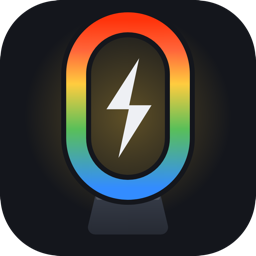
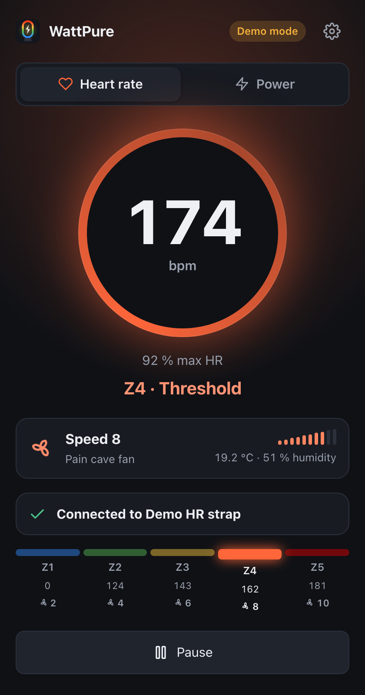
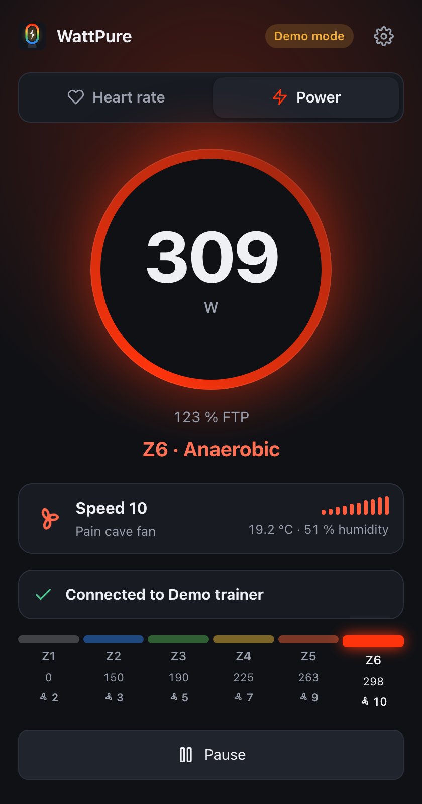
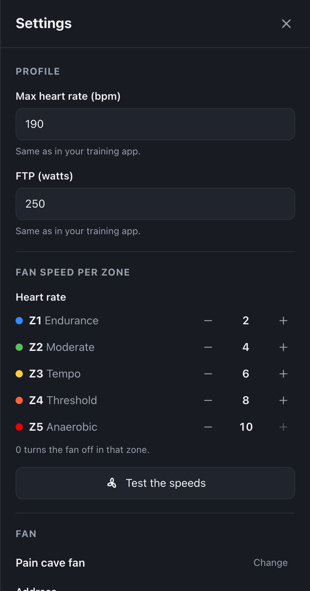
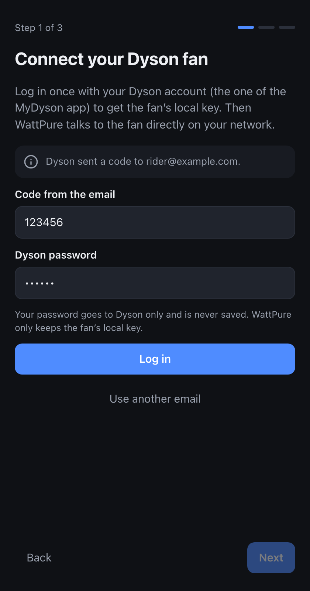
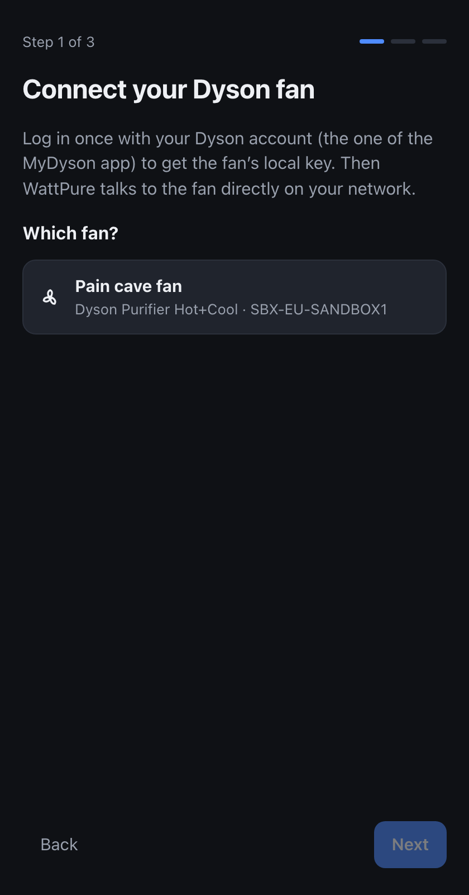
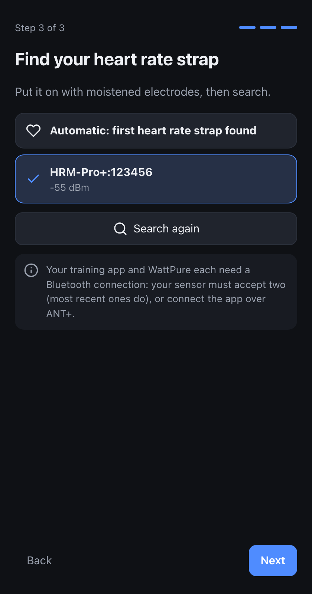

<p align="center">
  
</p>

<h1 align="center">WattPure</h1>

<p align="center">
  Your Dyson fan blows harder as you push harder, live,<br>
  from your heart rate strap, smart trainer or power meter.
</p>

<p align="center">
  
  
</p>

<p align="center">
  
  
  
</p>

Warm up with a breeze, get a gale on the hard intervals. WattPure reads your sensor over Bluetooth,
works out your training zone and sets the speed of your Dyson fan, through its own broker on your
local network. When you stop, the fan goes back to how it was.

It is the sibling of [WattLight](https://github.com/SiM07/wattlight), which does the same with Philips Hue lights.

## Features

- **Heart rate or power**, one click to switch. Heart rate (the default) follows how hot you get; power reacts instantly.
- **One fan speed per zone**, from 0 (off) to 10, set in two clicks: five heart rate zones from your max HR, six power zones from your FTP.
- **Cools you down after the effort**: the fan rises within seconds, holds its speed after an interval, then eases off one step at a time, like your body. No hunting when you ride on a zone boundary. [How it works](#after-the-effort).
- **Air right at you**: a dial on the main screen, like the one in the MyDyson app, points the air at you from the bike, to the degree. Or let WattPure find the best direction in three steps: it sweeps ±20° around the angle you set, 3° at a time, and you press *Stop* when the air hits you well; it then sweeps ±3° degree by degree and you press *Stop* again; finally correct it with −1° / +1° (saved at once) and tap *Done*. Your reaction time is allowed for, and touching the dial takes over at any time. No sweep while riding: the fan stays put, and goes back to how it was when you stop.
- **Cool air only**: on a Hot+Cool fan, the heater is turned off while you ride, and night mode (which caps the speed) too. Both come back when you stop.
- **Two-minute setup**: log in once with your Dyson account to get the fan’s local key, pick the fan, find your sensor.
- **Local, after setup**: WattPure finds the fan on your network (mDNS) and talks to it directly. No cloud, no account token kept.
- **Keeps looking for you**: strap not on yet, trainer still asleep, Bluetooth disabled, fan unplugged… the app tells you what to do and retries on its own.
- **Room readings**: temperature and humidity measured by the fan, on the main screen.
- **Puts the fan back** as it was when you pause or quit: off, auto mode, speed, heater.
- **Stops when you do**: no measurement for 2 minutes (strap off, trainer stopped or out of range), and the fan goes back to how it was, as on a pause (or off, if you chose not to restore it). It follows you again with your next measurement.
- **Lightweight**: a native window using the webview already in your system (no bundled browser), English and French.

## Zones and speeds

**Heart rate** (% of max HR):

| Zone | % max HR | Fan speed |
| --- | --- | --- |
| Z1 Endurance | < 65 % | 2 |
| Z2 Moderate | 65–75 % | 4 |
| Z3 Tempo | 75–85 % | 6 |
| Z4 Threshold | 85–95 % | 8 |
| Z5 Anaerobic | > 95 % | 10 |

**Power** (% of FTP, 3 s average):

| Zone | % FTP | Fan speed |
| --- | --- | --- |
| Z1 Recovery | < 60 % | 2 |
| Z2 Endurance | 60–75 % | 3 |
| Z3 Tempo | 76–89 % | 5 |
| Z4 Threshold | 90–104 % | 7 |
| Z5 VO2max | 105–118 % | 9 |
| Z6 Anaerobic | > 118 % | 10 |

Change the speeds in *Settings › Fan speed per zone*; 0 turns the fan off in that zone. *Test the
speeds* runs the fan through every zone. The zones themselves can be replaced in the [settings file](#settings-file).

## After the effort

A fan that simply follows your zone would be wrong twice: it would slow down the moment you ease
off, when you need it most, and it would hunt between two speeds when you ride on a zone boundary.
WattPure drives the fan from a small model of how your body heats up and cools down:

- **Up quickly.** Heart rate already lags the effort by 20 to 40 s or more, so with heart rate the fan
  follows within a few seconds. Power reacts instantly, so it is smoothed a little more (about 15 s):
  a 10-second sprint does not send the fan to full speed.
- **Hold, then down slowly.** After a hard effort, your core stays hot for many minutes while sweating
  drops quickly: that is when airflow helps most. The fan holds its speed for a while (longer after a
  longer effort, up to a minute with the *Normal* setting), then comes down one step at a time.
- **Longer efforts, longer cool-down.** The model keeps track of the heat you build up: after 30 s at
  full effort the fan is back to the recovery speed in about 3 minutes, after 5 minutes in about 8.
- **No hunting.** A speed only changes once the model is well past the halfway point between two
  speeds, and it goes down at most one step every 15 s.

*Settings › After the effort* picks *Short*, *Normal* (default), *Long*, or *Follow the zones directly*.
While the fan is cooling you down, the main screen shows where it is heading, e.g. *Speed 8 → 4*.
The cool-down needs measurements: after 2 minutes without any, WattPure lets go of the fan (see *Stops when you do*).

## What you need

- A **Dyson purifier fan connected to the MyDyson app**: Pure Cool and Purifier Cool (TP04, TP07, TP09, DP04…),
  Pure Hot+Cool and Purifier Hot+Cool (HP04, HP07, HP09…), Pure Humidify+Cool (PH01–PH04), Big+Quiet,
  and the first Pure Cool Link generation. WattPure drives them through [dyson-control](https://github.com/cheziyi/dyson-control),
  which lists [every supported type](https://github.com/cheziyi/dyson-control#machines).
- A **Bluetooth LE sensor** using the standard profiles:
  - heart rate: the *Heart Rate* service (Garmin HRM, Polar H9/H10, Wahoo TICKR, watches that broadcast HR…);
  - power: the *Cycling Power* service, offered by nearly every smart trainer (Tacx, Wahoo KICKR, Elite, Saris…) and power meter.
- A computer with Bluetooth 4.0 or later, on the same network as the fan:
  - macOS 11 or later (Apple silicon or Intel);
  - Windows 10 (1703) or 11, x64;
  - Linux x64 or arm64 (Raspberry Pi 4/5 included) with BlueZ.

> **Sharing the sensor with your training app.** Your training app and WattPure each need their own Bluetooth connection.
> Most recent trainers and straps accept two (a Garmin HRM-Pro takes two Bluetooth connections plus ANT+).
> If yours accepts only one, connect the training app over ANT+ (or through its companion phone app) and leave Bluetooth to WattPure.

## Install

Download the bundle for your system from the [latest release](../../releases/latest). Each bundle contains
everything it needs, including its own Node.js runtime: there is nothing else to install.

### macOS

1. Unzip `wattpure-<version>-darwin-arm64.zip` (Apple silicon) or `…-darwin-x64.zip` (Intel) and move **WattPure** to *Applications*.
2. The app is not notarized by Apple. The first time, open it, then go to *System Settings › Privacy & Security* and click **Open Anyway**.
   (Or run `xattr -dr com.apple.quarantine /Applications/WattPure.app` once.)
3. Allow **Bluetooth** and **Local Network** access when macOS asks.

Logs go to `~/Library/Logs/wattpure.log`.

### Windows

1. Unzip `wattpure-<version>-win32-x64.zip`, for instance in `Documents`.
2. Double-click **wattpure.cmd**. If SmartScreen warns you, click *More info › Run anyway*.
   A minimized console window holds the logs; closing it quits the app.

The window uses Microsoft Edge WebView2, included in Windows 11 and installed with Edge on Windows 10.

### Linux

On Debian, Ubuntu or Raspberry Pi OS, install the package (`amd64` or `arm64`): apt brings what it needs,
and WattPure appears in the applications menu.

```bash
sudo apt install ./wattpure_<version>_amd64.deb
wattpure                                    # or from the applications menu
```

The native window needs Ubuntu 24.04, Debian 13 or later; on older systems (Debian 12, Raspberry Pi OS
bookworm), WattPure opens in your browser. On a headless machine (`wattpure run`), add
`--no-install-recommends` to leave out WebKitGTK.
Uninstall with `sudo apt remove wattpure`.

On other distributions, use the portable bundle:

```bash
tar -xzf wattpure-<version>-linux-x64.tar.gz
./wattpure/wattpure                        # start
./wattpure/install-desktop-entry.sh         # optional: add it to your applications menu
```

Bluetooth goes through BlueZ over D-Bus: no root needed, `bluetoothd` keeps running.
The native window needs WebKitGTK 4.1 (`sudo apt install libwebkit2gtk-4.1-0 libxdo3` on Debian/Ubuntu);
without it, WattPure opens in your browser instead.

### From source

With Node.js 26 or later:

```bash
git clone <this repository> && cd wattpure
npm ci
npm start
```

## First launch

The setup walks you through three steps, each saved right away:

1. **Fan**: type the email of your Dyson account, then the code Dyson emails you and your password. Pick
   your fan in the list: WattPure keeps its local key, checks that it answers on your network, and
   forgets everything else. Your password goes to Dyson only and is never saved.
2. **Heart rate or power**, with your max HR or FTP (the same values as in your training app).
3. **Sensor**: wake it up, search, and pick it, or keep *Automatic* to use the first one found.

<p align="center">
  
  
  
</p>

Already have the fan’s local key (from libdyson, Home Assistant…)? *Enter the details by hand* takes
the serial number, the product type and the key, with no Dyson account involved.

Then ride. Everything can be changed later with the ⚙ button: speeds per zone, max HR and FTP, fan,
heater and restore options, sensors, language.

## Troubleshooting

The cards under the gauge tell you what is going on. The most common messages:

| Message | What to do |
| --- | --- |
| *Heart rate strap not found* | Put the strap on with moistened electrodes. WattPure searches again every 5 s. |
| *Trainer not found* | Turn the trainer on and pedal a few strokes: most trainers sleep until they move. |
| *Cannot connect to …* | The sensor is probably already used by another app over Bluetooth. See *Sharing the sensor with your training app* above. |
| *No skin contact* | Moisten the electrodes and tighten the strap just below your chest. |
| *WattPure is not allowed to use Bluetooth* | macOS: *System Settings › Privacy & Security › Bluetooth*, allow WattPure (or your terminal when started from source), then restart the app. |
| *Cannot reach the fan* | Check that the fan is plugged in and that the computer is on the same network (not a guest Wi-Fi). On macOS, allow *Local Network* access. If your router blocks mDNS, type the fan’s IP address in *Settings › Fan › Address* (and reserve it on your router). |
| *The fan refused the password* | The fan was reset or re-paired in the MyDyson app: *Settings › Fan › Change*, and log in again. |
| *Dyson sent a code a moment ago* | Dyson limits how often it emails codes: wait a minute. |

## Command line

The app is also a command-line tool: `wattpure` with the Debian package, `./wattpure` in the Linux bundle,
`/Applications/WattPure.app/Contents/MacOS/wattpure` on macOS, `node.exe app\dist\src\main.js`
in the Windows folder, `node dist/src/main.js` from source.

```text
wattpure [options]         open the app
wattpure run [options]     drive the fan from the terminal, without the app window
wattpure scan [--source]   list the Bluetooth sensors in range

  --demo                 simulated sensor (the fan is real)
  --sandbox              everything simulated, with a separate settings file: no hardware needed
  --browser              open the app in the default browser instead of a window
  --source <hr|power>    heart rate (default) or power          (run, scan)
  --ftp <watts>          FTP                                     (run)
  --max-hr <bpm>         max heart rate                          (run)
```

`run` uses the saved settings (set up the fan once in the app), which makes it handy on a
Raspberry Pi without a screen. Command-line values are not saved.

## Settings file

Settings live in `~/.config/wattpure/config.json` (`%APPDATA%\wattpure\config.json` on Windows,
`$XDG_CONFIG_HOME/wattpure` when set). The app writes it; you only need to edit it for the advanced keys:

| Key | Default | Meaning |
| --- | --- | --- |
| `source` | `"hr"` | `"hr"` or `"power"` |
| `maxHr` / `ftp` | `190` / `250` | references of the zones |
| `hrSpeeds` / `powerSpeeds` | `[2,4,6,8,10]` / `[2,3,5,7,9,10]` | fan speed of each zone, 0 (off) to 10 |
| `fan` | `null` | the fan: serial number, type and local key, set by the setup |
| `fanHost` | `null` | IP address or host name of the fan; `null` = found on the network |
| `cooldown` | `"normal"` | after the effort: `"off"`, `"short"`, `"normal"` or `"long"` |
| `airDirection` | `"keep"` | while riding: `"keep"` (as set on the fan) or `"fixed"` |
| `airAngle` | `null` | direction in `"fixed"` mode, 5 to 355 degrees clockwise, as in the MyDyson app; `null` = where the fan points |
| `coolOnly` | `true` | turn the heater off while riding |
| `restoreOnExit` | `true` | put the fan back as it was when pausing or quitting |
| `hrm` / `powerMeter` | `null` | `{ "id", "name" }` of the sensor; `null` = first one found |
| `powerSmoothingS` | `3` | power rolling average, in seconds |
| `hysteresisBpm` / `hysteresisW` | `3` / `5` | margin before going down a zone |
| `hrZones` / `powerZones` | `null` | custom zones, see below; `null` = the zones above |
| `language` | `null` | `"en"`, `"fr"`, or `null` for the system language |

Custom zones, as a share of max HR or FTP (the color tints the app; give one speed per zone in `hrSpeeds`):

```json
"hrZones": [
  { "name": "Easy", "fromPct": 0, "color": "#338CFF" },
  { "name": "Hard", "fromPct": 0.85, "color": "#FF340C" }
],
"hrSpeeds": [3, 10]
```

## Privacy and security

- Once set up, everything runs on your computer and your local network: the fan is driven through
  its own MQTT broker, found by mDNS.
- The Dyson cloud is only used during the setup, to read the fan’s local key. Your Dyson password and
  the account token are never stored; the local key stays in the settings file (readable by your user
  only) and is never sent to the UI.
- The app window talks to its own process through a server bound to `127.0.0.1`, protected by a
  random token drawn at each launch and by a `Host` check: web pages cannot drive it.

## Development

Requirements: Node.js 26 or later, pinned in `.nvmrc` (tests and build scripts run TypeScript directly).

```bash
npm ci
npm run sandbox      # the whole app with a simulated fan, Dyson account and sensor: no hardware needed
npm run demo         # simulated sensor, real fan
npm start            # the real thing
npm run check        # typecheck + lint + tests
npm run package      # portable bundle for this machine, in release/
npm run icons        # regenerate assets/ from ui/icon.svg (macOS, Google Chrome)
```

How it fits together:

```text
src/
  main.ts          command line: app, run, scan
  desktop.ts       starts the engine and the server, opens the window (or the browser), quits cleanly
  window.ts        native window process (@webviewjs/webview: WebKit, WebView2, WebKitGTK)
  server.ts        local HTTP API + server-sent events for the UI, token protected
  engine.ts        Session: sensor -> zone -> fan speed, status codes, watchdog, restore
  cooling.ts       cooling curve: quick rise, hold and slow fall after the effort, no hunting
  dyson.ts         Dyson fan and account, through dyson-control
  ble.ts           Bluetooth LE sensors (noble): Heart Rate and Cycling Power services
  zones.ts         training zones, hysteresis, rolling average
  config.ts        settings file, validation
  fakes.ts         in-memory fan, Dyson account and scan, for the tests and --sandbox
  shared/          types and translations, shared with the UI
ui/                the interface: TypeScript without framework, compiled by tsc
test/              node:test suites
scripts/           build, packaging and icons
```

The engine never formats text: it publishes status codes (`notFound`, `noContact`…) that the UI and
the command line translate with `src/shared/locales/`. To add a language, copy `fr.ts`, translate it,
and register it in `src/shared/i18n.ts` and `src/config.ts`.

### Releasing

1. Update the version in `package.json` and the `CHANGELOG.md`.
2. Tag and push: `git tag v1.2.3 && git push --tags`.
3. The *Release* workflow checks, builds the five bundles (macOS arm64/x64, Windows x64, Linux x64/arm64)
   plus the Debian packages (amd64/arm64)
   and publishes them with their SHA-256 checksums.

See [CONTRIBUTING.md](CONTRIBUTING.md) for the conventions.

## License

[MIT](LICENSE). WattPure is an independent project, not affiliated with or endorsed by Dyson.
Dyson, Pure Cool and Hot+Cool are trademarks of Dyson Technology Limited. The fan is driven with
[dyson-control](https://github.com/cheziyi/dyson-control) (MIT).
